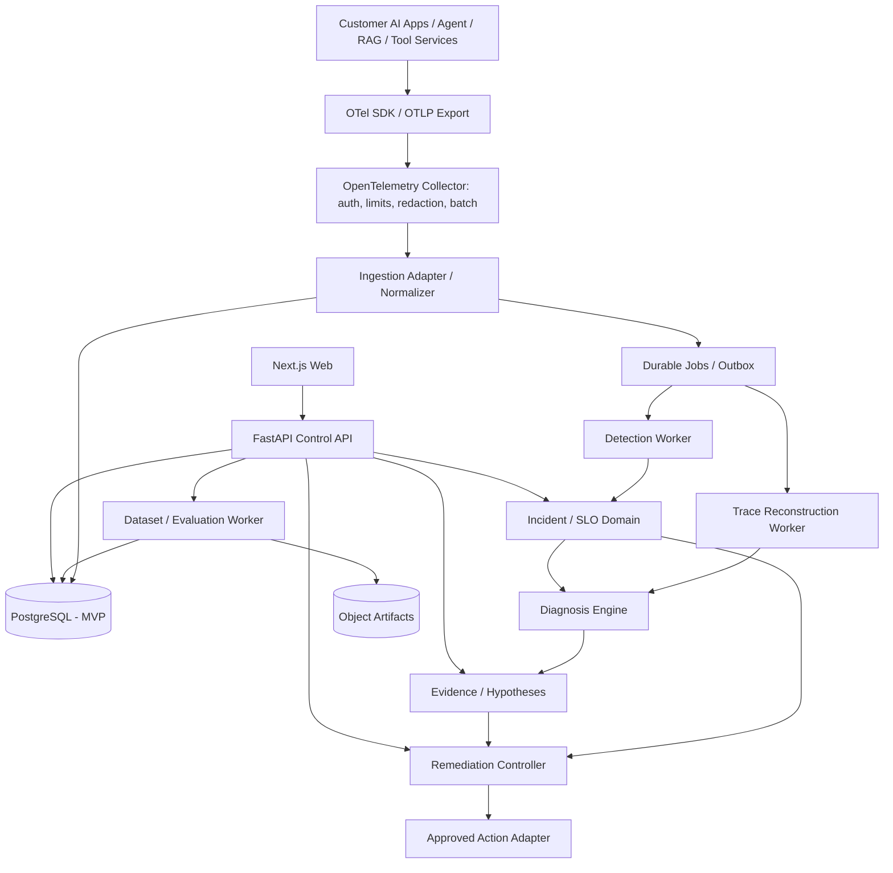

# NeuralOps — Technical Architecture

**Status:** Proposed design, not a claim that services are implemented. **Companion files:** `Design.md`, `Component.md`, `Security.md`, `Flow.md`.

## 1. Scope and boundaries
NeuralOps is an independent, framework-agnostic control plane for AI application telemetry, incident detection, evidence-based diagnosis, versioned evaluation and approval-controlled remediation. It does not orchestrate user tasks like Lucifer; it can instrument Lucifer as one client among many. Operational core must work without an LLM. Remote actions are **off by default**.

## 2. Logical architecture

Advanced data-plane options: ClickHouse for large span analytics; Redpanda/Kafka between collector and workers for high throughput; S3-compatible artifact store; Kubernetes/Helm for scaling. None are mandatory for MVP.

## 3. Components and ownership
| Runtime | Responsibilities | Forbidden responsibilities |
|---|---|---|
| Web/Next.js | navigation, data presentation, forms, accessibility | secrets, authorization decisions, remediation execution |
| API/FastAPI | OIDC sessions, policy checks, resource APIs, validation, scheduling jobs | high-volume trace computations inside requests |
| Collector | OTLP receiver, auth, metadata filtering/redaction, bounded buffering | incident/diagnosis business logic |
| Ingestion adapter | schema normalization, tenant resolution, idempotent upsert, span lineage | trusting producer-supplied organization IDs |
| Worker | aggregation, detection, trace assembly, evaluation scheduling | cross-tenant reads without authorization context |
| Diagnosis | hypothesis generation, evidence ranking, uncertainty/coverage reporting | asserting correlation is proof of cause |
| Remediation | state machine, action manifest pinning, approval and executor authorization | arbitrary shell, unconstrained cloud access |
| Database | transactional truth, incidents, rules, audit references | unlimited raw prompt storage |

## 4. Deployment topology
**MVP:** `web`, `api`, `worker`, `otel-collector`, `postgres` in local Docker Compose; optional reverse proxy with TLS on hosted installations. Same repository, independently deployed processes. API and worker use migration-managed PostgreSQL. Background work uses durable PostgreSQL job table with leases/heartbeat/retries and an outbox; Redis not required. External identity provider via OIDC; local dev auth may be used only behind a clearly isolated development mode.

**Scale-up:** horizontal stateless API and workers; ClickHouse partitions by organization/project and time; Kafka/Redpanda for durable streams; object storage for immutable fixtures and reports; Kubernetes with resource quotas, HPA and safe rollouts. Migration requires backfill and query-parity tests, not blanket replacement.

## 5. Data contracts
Core records: `Organization`, `Membership`, `Project`, `IngestionCredential`, `Trace`, `Span`, `MetricWindow`, `RuleVersion`, `Detection`, `Incident`, `Hypothesis`, `EvidenceLink`, `Dataset`, `DatasetVersion`, `EvaluationRun`, `EvaluationCaseResult`, `RemediationProposal`, `Approval`, `ExecutionAttempt`, `AuditEvent`. Globally unique internal identifiers; all resource queries derive tenancy from authenticated context, not only URL parameters.

Trace identity composite: `(organization_id, project_id, trace_id)`; span uniqueness adds `span_id`. Preserve raw semantic attributes only after validation/redaction, schema version recorded for normalized representation; indexed typed fields for status, operation, times, duration, service and model. Guard maximum attributes, event count, nesting and payload size. Store original timestamps and ingestion timestamps, explicit clock-skew annotations.

API prefix `/v1`; OpenAPI published; pagination cursor+stable sorting, request id, error envelope `{code, message, request_id, details?}` with no secret data. Idempotency keys for job creation and remediation state mutations. List responses filter by project and time. Contract compatibility via schema versioning and CI fixtures.

## 6. Algorithms and domain behavior
- **Reconstruction:** idempotent merge unordered spans into parent-child DAG, detect cycles, missing parents, retries and links; compute critical path with parallelism respected. Never sum overlapping span durations for end-to-end latency.
- **Metrics:** successful executions / eligible completed executions; latency histograms and explicit percentile algorithms; token/cost totals from present and attributed spans only, unknown vs zero distinction.
- **Detection:** threshold rules first; min-sample safeguards; EWMA and robust MAD for statistical detectors; condition/window/cooldown; separate anomaly, alert grouping and incident creation; one incident per deduplication key and active window.
- **Diagnosis:** ranked hypotheses using temporal alignment, dependency locality, deployment correlation, symptom coverage and counterevidence; show missing evidence and confidence class only if defined/calibrated; no autonomous change.
- **Evaluation:** immutable dataset version + baseline/candidate manifests; paired runs, task-specific graders, repeat controls; per-case deltas, confidence intervals/non-inferiority policies and guardrails; results can be INCONCLUSIVE.
- **Remediation:** PROPOSED → VALIDATED → APPROVED → EXECUTING → VERIFIED; alternate terminal/rollback paths. Every transition checks current state, authorization, TTL, action hash and preconditions; executor isolated and allowlisted.

## 7. APIs (planned resource contract)
| Resource | Methods | Notes |
|---|---|---|
| `/v1/projects` | GET/POST/PATCH | scoped settings |
| `/v1/traces`, `/v1/traces/{id}` | GET | query/inspect |
| `/v1/metrics/summary`, `/v1/services` | GET | aggregated SLI/service health |
| `/v1/rules`, `/v1/rules/preview` | GET/POST/PATCH | versioned rule changes and non-persisting bounded preview |
| `/v1/detections` | GET | persisted normal/anomaly/insufficient evaluations |
| `/v1/slos` | GET/POST/PATCH | objective definitions, measured snapshots and trends |
| `/v1/changes` | GET/POST | explicit deployment/configuration evidence |
| `/v1/incidents`, `/v1/incidents/{id}` | GET/PATCH | incident lifecycle |
| `/v1/incidents/{id}/hypotheses` | GET | linked evidence |
| `/v1/datasets`, `/v1/datasets/{id}/versions` | GET/POST | immutable published versions |
| `/v1/evaluations`, `/v1/evaluations/{id}` | GET/POST | queued, async processing |
| `/v1/remediations`, `/v1/remediations/{id}` | GET/POST | proposal read/create |
| `/v1/remediations/{id}/approve` | POST | separate approver policy |
| `/v1/remediations/{id}/execute` | POST | allowlisted action only |
| `/v1/audit` | GET | read-only audited access |

Note: ingestion uses authenticated OTLP at Collector, not a custom public spans REST endpoint. API endpoints are interface intent, not claims of existing implementation.

Phase 2 implementation note (verified 2026-10-25): PostgreSQL stores tenant-scoped detections, SLO definitions/snapshots and change events. The existing leased worker evaluates these records under a per-project advisory lock; uniqueness keys make concurrent redelivery idempotent. Trace rows persist inferred critical-path span IDs/duration, and hypothesis rows persist algorithm version, coverage, dependency context, correlated changes, and normalized supporting/contradicting evidence links. No new service or broker was introduced.

## 8. Operational engineering
Instrument NeuralOps itself (API latency, queue depth/lag, ingest rejected/dropped, DB connections, evaluator duration, action rejection, failed logins). Retention configured per tenant/project; separate hot trace and incident retention. Backups encrypted and restoration rehearsed. Readiness differs from liveness; sustained load shedding must not crash monitored apps. Set and measure SLOs for platform availability, ingestion completeness, and incident detection delay, with environment-specific thresholds.

## 9. Architecture ADRs to write
`ADR-001 modular-monolith`; `ADR-002 OTLP boundary`; `ADR-003 Postgres job/outbox`; `ADR-004 trace schema`; `ADR-005 OIDC/tenant isolation`; `ADR-006 remediation executor boundary`; `ADR-007 advanced ClickHouse/Kafka adoption trigger`.

## 10. Delivery plan
Weeks 1–3 foundation and threat model; 4–5 telemetry; 6–7 detection/incident; 8–9 evidence-based diagnosis; 10–12 dataset/evaluation; 13–14 approved remediation; 15–16 qualification. Advanced stage only after load and operational evidence justify additional infrastructure. Reference `Flow.md` for each sequence and `Security.md` for release gates.
