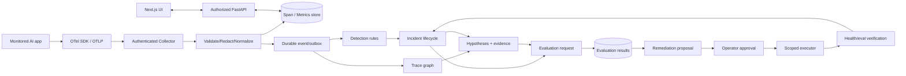
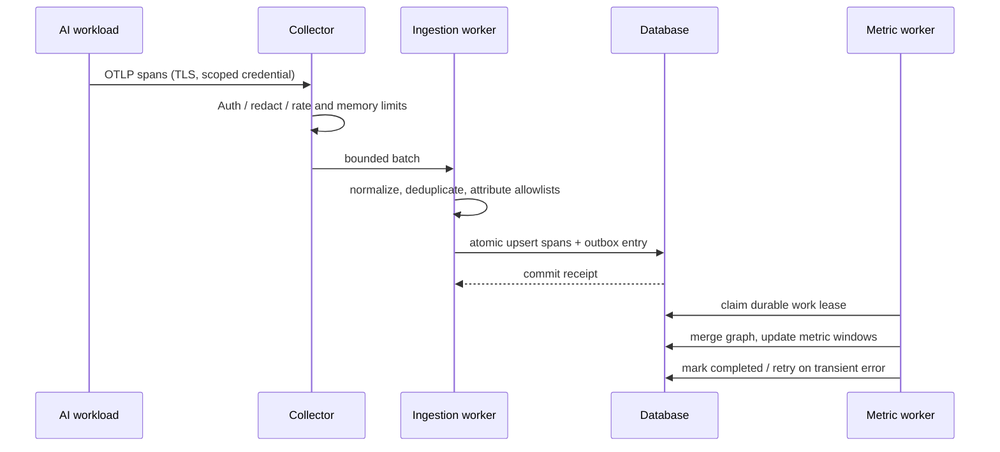
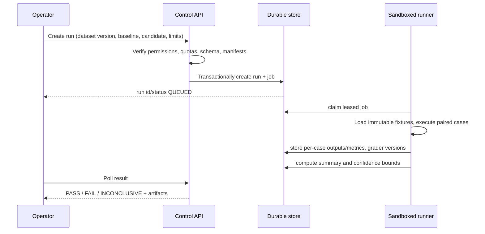
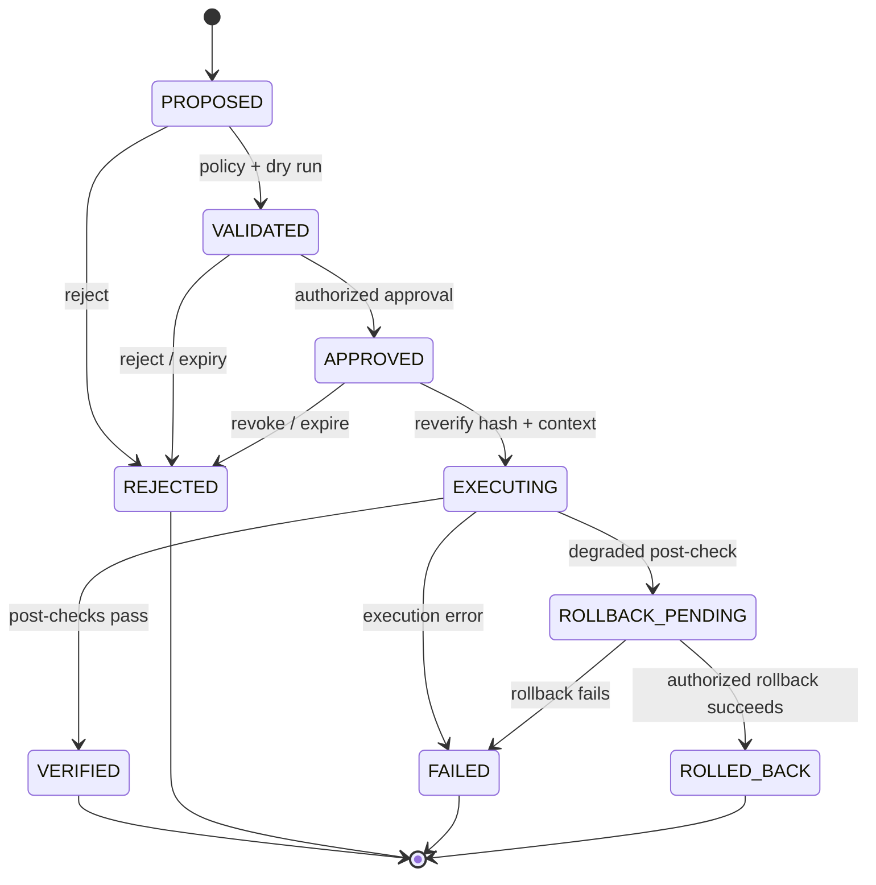

# NeuralOps — Complete Data & Control Flow

This document specifies end-to-end flows, state transitions, failure handling and traceability. All flow diagrams describe intended architecture. Reference `Architecture.md` for data models, `Component.md` for UI owners, `Security.md` for trust boundaries.

## 1. System data flow overview

No application executes remediation merely because an anomaly or LLM output suggests it.

## 2. Flow A — onboarding and instrumentation
1. Authenticated admin creates organization/project/environment via wizard.
2. API checks role and creates project with default privacy rules: metadata-only collection, retention and quotas.
3. Admin requests an ingestion credential scoped to project/environment. Server returns secret **once**; stores only a verifier/hash or secure secret-manager reference as appropriate.
4. Wizard renders applicable OpenTelemetry configuration template with explicit credential handling.
5. Monitored app emits test span → OTLP transport → Collector authenticates credential and binds canonical tenant scope.
6. Collector applies limits/redaction and forwards to normalizer; normalizer validates schema and persists trace/span.
7. Connection verifier queries scoped last-received test span. Only confirmed telemetry marks the integration connected; timeout shows not yet verified, not success.
8. Audit logs project/credential changes without the secret.

Failure paths: invalid/revoked credential → reject without persistence; missing span → retry test and show diagnostic; schema mismatch → bounded rejection, versioned reason and ingest metrics.

## 3. Flow B — ingest, reconstruction and aggregation

Dedup key `(tenant, project, trace_id, span_id)`. Do not assume arrival order. Keep incomplete traces distinct from missing traces, use ingestion timestamps for late arrivals, detect cycles and missing parents; preserve span links. End-to-end execution latency uses root/wall-clock spans, accounting for parallel operations. At-least-once job execution is expected; handlers must be idempotent. If persist succeeds but worker fails, durable work remains retryable. After bounded retries, dead-letter state is operator visible. On backpressure, bounded buffering and drop/reject counters prevent a customer app outage.

## 4. Flow C — metrics, detection and incident creation
1. Eligible traces produce typed measurement windows by org/project/service/model/tool and fixed UTC buckets.
2. Each configured rule version evaluates only appropriate complete/eligible samples, with a minimum count and bounded window.
3. Threshold, EWMA or robust median/MAD evaluation returns observed/baseline/deviation/score and `NORMAL|ANOMALY|INSUFFICIENT_DATA`; statistical firing requires both its absolute threshold and configured sensitivity.
4. Upsert one durable detection per tenant/project/rule/evaluation minute, including bounded evidence references. Detection is not an incident by itself.
5. Cooldown and active-incident grouping apply after detection. If qualified, create/update the incident, attach the detection, append timeline evidence and queue diagnosis.
6. In the same serialized project worker transaction, each enabled SLO calculates eligible/good counts, compliance, remaining error budget and short/long burn. Upsert a per-minute snapshot; sparse/missing data remains insufficient.
7. Command Center, Rules, SLOs and Incidents display persisted state and link to exact trace evidence.

SLO computation: define eligible denominator and error budget per objective; missing telemetry must not be treated as 100% reliability. Suppression, acknowledgement and resolution are distinct states with audited actor/time.

## 5. Flow D — diagnosis and evidence
1. Operator opens incident → API verifies access → returns incident, affected services, rule result and evidence links.
2. Diagnosis worker constructs dependency subgraph from correlated traces and timestamps, annotated with missing spans.
3. Candidate hypotheses come from failure localization, recent deploy/config changes, propagation patterns and downstream errors.
4. Score/rank candidates using temporal sequence, symptom coverage, dependency proximity and counterevidence. Preserve rank inputs and algorithm version.
5. Persist `Hypothesis` with evidence references and `unknown/partial/strong` evidence classes; **do not claim proved cause**.
6. Root Cause view selects hypothesis → Evidence Inspector requests only authorized redacted spans and metric windows.
7. Operator can link more evidence, reject hypothesis or request an evaluation; notes/audit events are recorded.

Implemented Phase 2 sequencing: reconstruction first persists the inferred non-overlapping critical path. Diagnosis then reads at most 5,000 incident-linked spans, derives recorded parent-child service edges, reads at most 100 explicitly recorded changes from the bounded incident window, and replaces the incident's ranked hypotheses/evidence links transactionally. A newly recorded relevant change deduplicates and queues diagnosis refresh. Empty failure evidence returns an explicit insufficient-evidence response; temporal alignment never becomes a causal assertion.

If evidence is inadequate, return `INSUFFICIENT_EVIDENCE` and suggested missing measurements. Optional LLM synthesis receives minimum redacted read-only evidence; its output is visibly advisory, never authorizes actions.

## 6. Flow E — reproducible evaluation

Status: DRAFT → QUEUED → RUNNING → COMPLETED / FAILED / CANCELLED; completed summary decision independently PASS/FAIL/INCONCLUSIVE. Compare baseline and candidate on same dataset version and equivalent configuration, retain run manifest and seeds when supported. Enforce external model-call limits, runtime deadlines and egress restrictions. No raw secret-bearing outputs in report exports. Interrupted runs can resume idempotently at case level, not duplicate billing or counts silently.

## 7. Flow F — remediation approval, execution and recovery

1. Incident or evaluation result is linked to a typed remediation proposal; immutable manifest includes action type, target, exact parameters hash, risk, preconditions, expiry, rollback procedure.
2. Policy controller validates allowlist, role, tenant and evidence; dry run obtains target version/health.
3. Independent approver authorizes **exact hash**; record approver and time. UI gets confirmation only after persisted acknowledgment.
4. Execute request passes idempotency key; API revalidates approval, TTL, current target/configuration, preconditions and permissions, then schedules scoped executor.
5. Executor performs only approved typed operation under limited identity. It records receipts and outcome without secrets.
6. Post-conditions: sample health and/or run pinned evaluation; success becomes VERIFIED, not automatically 'incident resolved' unless explicit configured resolution criteria are met.
7. Degradation/error triggers failure or ROLLBACK_PENDING; rollback requires a predefined authorized action and is fully audited.

Race conditions: optimistic compare-and-swap on state/version; stale or duplicated requests never create a second action. Kill switch disables all executor mutation paths immediately.

## 8. Flow G — dashboard requests and UI navigation
- User signs in via OIDC; backend validates session. Sidebar and project selector list only accessible scopes.
- UI requests `/v1/metrics/summary?from=...&to=...` in selected organization/project with date validation; server derives org permissions and filters queries. Display measured timestamp and metric source.
- Clicking failure rate links to `/traces` with URL-encoded filters; trace selection opens `/traces/:id`; selected error span links to incident evidence if attached.
- Incident → RCA tab → hypothesis evidence → evaluation wizard → run detail → remediation proposal/approval. Deep links recheck access each request.
- On project switch, invalidate cached query state, cancel stale in-flight requests when possible and remove old-org data from browser views. No cross-tenant browser cache persistence.
- Polling uses visibility-aware intervals and backoff; eventual live transport can be added later. Auth errors revoke view state; network errors show stale/failed state.

## 9. Flow H — notifications, keys and audit
- Notification event is generated after transaction commit (outbox), filtered by route preferences, deduped and retried with capped attempts. It never sends sensitive trace body by default.
- API key issue/rotate/revoke is admin authorized, shown once, and recorded with identifier only. Existing revoked credentials cannot ingest after revocation propagation policy.
- Audit append is transactional with sensitive state changes where possible; audit viewer uses server-side role and tenant checks. Export requires privileged scope and recorded audit of the export itself.

## 10. Retention, deletion, backups and failure recovery
Retention scheduler removes expired spans/artifacts per organization policy and records deletion metadata. Incident references to deleted spans must show `evidence expired` instead of broken/misleading content. Long-lived reports should contain approved redacted snapshots or hashes rather than automatically preserving sensitive payloads. Encrypted backups and restore drills must exercise RPO/RTO targets defined by deployment operators, not invented values. DB outage → API read/write errors, workers retry; Collector saturation → controlled rejection and telemetry-loss counter; evaluation crash → leased job retry; compromised credential → immediate revocation path; executor fault → stop mutations and escalate for review.

## 11. End-to-end acceptance walkthrough
1. Create test project and credential.
2. Send a real, deterministic trace from example RAG application.
3. Observe trace and inspect waterfall and redacted span attributes.
4. Inject controlled retrieval timeout and obtain a real detection and incident.
5. Open RCA with ranked hypothesis and linked evidence; include uncertainty.
6. Run pinned baseline/candidate evaluation and compare case-level results.
7. Create allowlisted recovery proposal; reject an unauthorized execute attempt.
8. Approve exact action with eligible identity, execute in safe test environment.
9. Verify measured recovery and record receipt or rollback.
10. Confirm audit trail, scoped access, accurate dashboard state, and graceful failure under outages.

**Definition of done:** every transition observable, testable, authorization-checked, idempotent where required, with no fabricated telemetry or auto-approved production changes.
