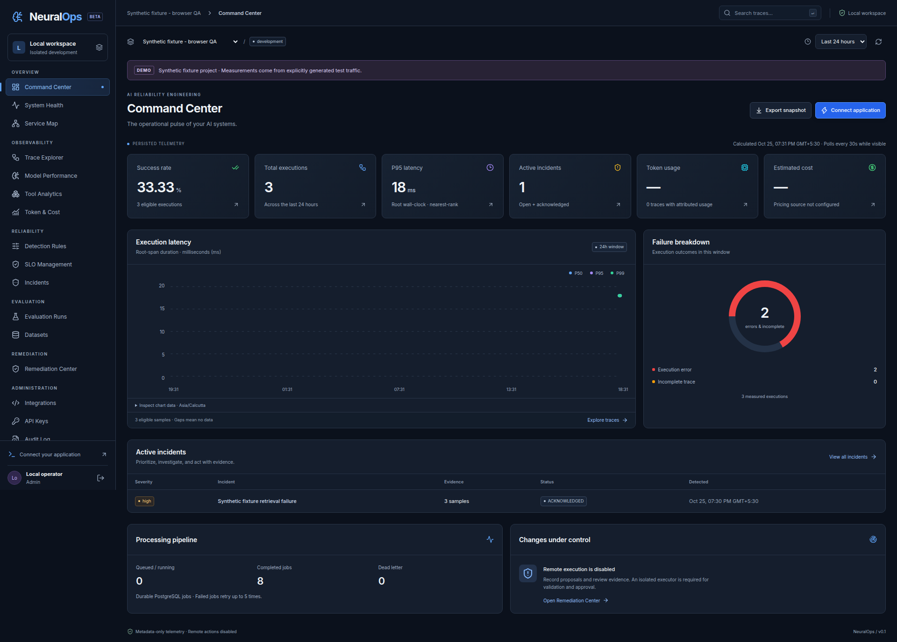

<div align="center">

# NeuralOps

**Deterministic AI Reliability & Observability Control Plane**

*High-assurance telemetry processing, deterministic incident localization, immutable replay grading, and guarded recovery.*

[](https://github.com/swayom123/NeuralOps/actions/workflows/ci.yml)
[](LICENSE)
[](pyproject.toml)
[](web/package.json)
[](web)
[](services)
[](compose.yaml)
[](https://github.com/astral-sh/ruff)
[](Security.md)

</div>

---

## Overview

**NeuralOps** is an open-source AI reliability control plane engineered for engineering teams operating production LLM applications and agent pipelines. Unlike traditional APM tools designed purely for microservices, or probabilistic LLM evaluation dashboards, NeuralOps provides **deterministic telemetry attribution, statistical error budget monitoring, reproducible replay grading, and fail-closed incident remediation.**

It is architected as a modular monolith with decoupled runtime processes: a responsive **Next.js operational console**, a high-performance **FastAPI control plane**, an authenticated **OTLP/HTTP gateway**, a transactional outbox **durable worker**, and **PostgreSQL 17** with strict Row-Level Security (RLS).

---

## Operational Console


*Figure 1: NeuralOps Operational Console — real render displaying multi-service health, error budget burn rates, trace waterfalls, and incident localization.*

---

## Status & Capabilities

> [!IMPORTANT]
> **Engineering Status:** NeuralOps has delivered its telemetry-to-incident vertical slice, deterministic evidence localization, immutable paired replay evaluations, guarded recovery proposals, and a fully responsive operational console. **This repository represents working, verified software, not a production-readiness certification.** Remote remediation execution is intentionally disabled by default. See [Verification Records](docs/VERIFICATION.md), [Threat Model](docs/security/threat-model.md), and [Release Gates](docs/security/release-gates.md).

### Implemented vs. Planned Capabilities

| Capability | Status | Description |
|---|:---:|---|
| **OTLP Ingestion Gateway** | :white_check_mark: **Delivered** | Standard `/v1/traces` OTLP/HTTP JSON & binary protobuf. Strict credential hashing (SHA-256 verifiers only). |
| **Telemetry Privacy** | :white_check_mark: **Delivered** | **Metadata-only default**. Prompts, completions, tool inputs/outputs, headers, and exception bodies are dropped prior to storage. |
| **Deterministic Critical Path** | :white_check_mark: **Delivered** | Inferred during trace reconstruction from parent-child timing, selecting longest branch among overlapping spans without sum distortion. |
| **Root Cause Localization** | :white_check_mark: **Delivered** | Ranks observed failing services using symptom coverage, dependency locality, and nearby change events. Flags missing measurements and counterevidence; never hallucinates certainty. |
| **Durable Jobs Engine** | :white_check_mark: **Delivered** | Transactional outbox pattern using PostgreSQL `FOR UPDATE SKIP LOCKED`, 60-second leases, and dead-letter queue bounds. |
| **Paired Replay Evaluation** | :white_check_mark: **Delivered** | Bounded offline grading comparing candidate outputs to immutable baselines with exact-match scores and 95% Hoeffding confidence intervals. |
| **Multi-Tenant Database Isolation** | :white_check_mark: **Delivered** | Composite `(organization_id, project_id)` keys and PostgreSQL Row-Level Security (RLS) with dedicated non-login runtime roles. |
| **Guarded Recovery Proposals** | :white_check_mark: **Delivered** | Immutable proposal records with parameter hashing, approval state machine, and expiry tracking. |
| **Remote Action Execution** | :warning: **Blocked by Design** | Remote execution is disabled until verified target adapters, isolated execution sandboxes, and automated health verification are configured. |
| **Distributed Streaming Pipeline** | :hourglass_flowing_sand: **Planned** | Optional Kafka / ClickHouse cold-storage backend for ultra-high-volume scale (> 500k spans/sec). |
| **Multi-Org Identity Selection** | :hourglass_flowing_sand: **Planned** | Self-service multi-tenant organization switching in UI. |

---

## System Architecture

```
                                  +---------------------------------------+
                                  |         Production Workloads          |
                                  |     (OpenTelemetry SDKs / Agents)     |
                                  +-------------------+-------------------+
                                                      |
                                                      | OTLP / HTTP (:4318)
                                                      | [Bearer Ingestion Credential]
                                                      v
+-------------------------------+         +-------------------------------+
|      Next.js 15 Console       |         |       OTLP Gateway            |
|   (TypeScript / Tailwind)     |         |    (FastAPI / Metadata Only)  |
|         Port 3000             |         +---------------+---------------+
+---------------+---------------+                         |
                |                                         | Transactional Outbox
                | Internal API Proxy (/api/v1/*)          | Insert Telemetry Batch
                v                                         v
+-------------------------------+         +-------------------------------+
|     FastAPI Control Plane     |         |     PostgreSQL 17 Database    |
|   (Sessions, RBAC, Projects,  |<------->|    (Row-Level Security, RLS   |
|   Rules, Datasets, Audits)    |         |   Composite Tenant/Project)   |
|         Port 8000             |         +---------------+---------------+
+-------------------------------+                         ^
                                                          |
                                          +---------------+---------------+
                                          |        Durable Worker         |
                                          | (Reconstruction, Detection,   |
                                          |  Replay Grading, Retention)   |
                                          |      [Leased Outbox Jobs]     |
                                          +-------------------------------+
```

### Process Boundaries

| Process | Port / Boundary | Role & Security Invariants |
|---|---|---|
| **Next.js Console** | `localhost:3000` | Operational UI. Proxies requests to `/api/v1/*`. Zero backend secrets or DB credentials in browser bundle. |
| **FastAPI Control API** | `localhost:8000` | Sessions, RBAC authorization, CRUD resources, OpenAPI generation in development. |
| **OTLP Gateway** | `localhost:4318` | Scoped bearer token authentication. Validates, drops non-allowlisted attributes, enforces request size and rate limits. |
| **Durable Worker** | Internal / No Port | Consumes leased PostgreSQL jobs via `SKIP LOCKED`. Performs trace reconstruction, anomaly detection, statistical evaluations, and retention. |
| **PostgreSQL 17** | `localhost:15432` | Durable relational store. Enforces composite tenant keys, RLS policies, immutable triggers, and transaction guarantees. |

---

## Architectural & Design Specifications

The repository includes detailed architectural and engineering specifications:

- [Architecture Specification (Architecture.md)](Architecture.md) — System boundaries, data models, schema definitions, and network topology.
- [Component Breakdown (Component.md)](Component.md) — Process decomposition, internal APIs, and service interfaces.
- [UX / UI Design (Design.md)](Design.md) — Operational dashboard workflows, dark-mode design system, and accessibility guidelines.
- [Information Flow (Flow.md)](Flow.md) — Telemetry ingestion flow, incident evaluation loop, and dataset evaluation lifecycles.
- [Security Specification & Protocols (Security.md)](Security.md) — Trust boundaries, threat models, database RLS rules, and vulnerability criteria.
- [Architectural Decision Records (REASON.md)](REASON.md) — Formal records for all major technical decisions (ADR-001 through ADR-014).
- [Implementation Plan (IMPLEMENTATION_PLAN.md)](IMPLEMENTATION_PLAN.md) — Phase 1, Phase 2, and Phase 3 roadmap and tracking.

---

## Technology Stack

- **Frontend:** Next.js 15 (App Router), React 19, TypeScript, Tailwind CSS, Lucide Icons, Headless UI.
- **Backend:** Python 3.12, FastAPI, Pydantic v2, SQLAlchemy 2.0 (Asyncio / Psycopg 3), Alembic, Authlib.
- **Data & Ingestion:** PostgreSQL 17 with Row-Level Security (RLS), OpenTelemetry (OTLP) Protobuf & JSON.
- **Tooling & Package Management:** `uv` (fast Python virtualenv/package manager), `npm`, Docker Compose.
- **Security & Quality:** Ruff, ESLint, Bandit, `pip-audit`, `detect-secrets`, Playwright (E2E & Axe accessibility).

---

## Quickstart

### Prerequisites
- **Node.js**: v22+
- **Python**: v3.12+
- **uv**: Python package manager (`curl -LsSf https://astral.sh/uv/install.sh | sh`)
- **Docker & Docker Compose**: For local PostgreSQL 17

### 1. Automated Setup & Dev Server

```bash
# Clone repository
git clone https://github.com/swayom123/NeuralOps.git
cd NeuralOps

# Setup virtual environment, dependencies, and local credentials
make setup

# Start PostgreSQL and launch API, Gateway, Worker, and Web Console
make dev
```

Navigate to **[http://localhost:3000](http://localhost:3000)** in your browser.

> [!NOTE]
> `make setup` generates a private, local `.env` containing cryptographically random development secrets. Secrets are never logged or committed. Always access the console via `http://localhost:3000` rather than `127.0.0.1:3000` to comply with strict CSRF origin verification.

### 2. Full Containerized Deployment (Docker Compose)

```bash
python3 scripts/setup-local.py
docker compose up --build -d
```

Containers run unprivileged with read-only filesystems, dropped Linux capabilities, and loopback port bindings. To stop containers while preserving database volume: `docker compose down`.

---

## First Working Journey

1. **Access Console:** Open `http://localhost:3000` and create or select a development project.
2. **Issue Ingestion Key:** Navigate to **API Keys** and generate an ingestion credential. Save the secret key (it is only displayed once; only a SHA-256 verifier is persisted).
3. **Configure Workload:** Ingestion endpoint accepts OTLP/HTTP on `http://localhost:4318/v1/traces`.
4. **Send Telemetry:** Run the bundled synthetic generator:
   ```bash
   python3 examples/send_trace.py --count 3 --inject-timeout
   ```
5. **Detection & Grouping:** The worker reconstructs spans into traces, computes critical paths, and flags anomalies exceeding configured error thresholds.
6. **Investigate Incident:** Inspect the trace waterfall, root cause hypothesis, and evidence links on the **Incidents** page.
7. **Paired Replay Evaluation:** Publish authorized replay fixtures under **Datasets** and run an evaluation. Inspect exact-match scores and 95% Hoeffding intervals.
8. **Guarded Recovery:** Record a recovery proposal. Notice that execution fails closed until an isolated executor and target health verification adapters are configured.

---

## Quality, Testing & Security Verification

NeuralOps enforces verification gates covering backend logic, database migrations, security scans, and browser flows:

```bash
# 1. Run all code quality checks (Ruff, Pytest, ESLint, Typecheck, Build)
make check

# 2. Security static analysis & dependency audits
uv run --directory services bandit -r neuralops -ll
uv run --directory services pip-audit --local
npm audit --prefix web --audit-level=low

# 3. Secret scanners (entropy & known credentials)
uv run --directory services python ../scripts/scan-secrets.py
python3 scripts/check-secrets.py

# 4. End-to-end browser & accessibility testing (requires running app)
npm run test:e2e --prefix web
```

For detailed audit reports and verification history, refer to [Verification Record (docs/VERIFICATION.md)](docs/VERIFICATION.md) and [Security Release Gates (docs/security/release-gates.md)](docs/security/release-gates.md).

---

## Contributing

Contributions are welcomed! Please review [CONTRIBUTING.md](CONTRIBUTING.md) for details on code formatting, testing standards, and our pull request process.

---

## Security Policy

For vulnerability reporting instructions and safe harbor terms, please read [.github/SECURITY.md](.github/SECURITY.md).

---

## License

NeuralOps is open-source software licensed under the [Apache License, Version 2.0](LICENSE).
